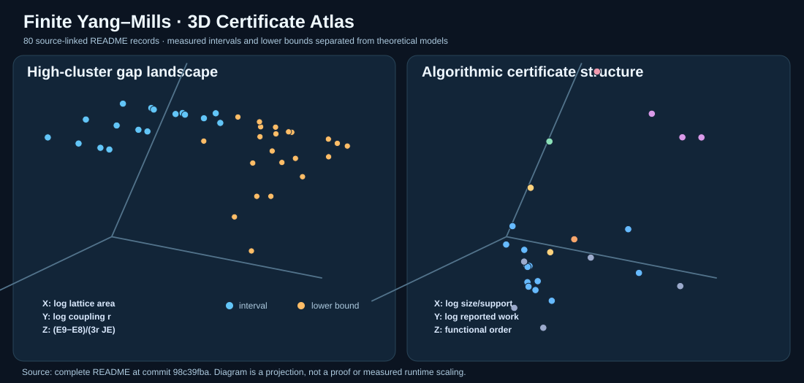

# Three-dimensional Yang–Mills certificate atlas

**What does the research look like?** This is a source-linked map of the finite Yang–Mills certificates reported throughout this repository's main README, captured at [commit `98c39fbaa1e6ecf9e6454062e90801f385356063`](https://github.com/JesseBrown1980/Finite-universe-Yang-mills-existence-and-mass-gap-using-HEB-C/blob/98c39fbaa1e6ecf9e6454062e90801f385356063/README.md) on November 17, 2026.

## View the graph

- **[Mobile-friendly offline interactive graph](index.html):** four switchable views and three precomputed 3D camera angles for gap measurements, physical versus Ritz spectra, algorithmic certificates and predicted polynomial-filter convergence. GitHub's ordinary file viewer shows HTML source instead of running it. To interact, download `index.html` (the **Raw / Download raw file** control on GitHub) and open the saved file in Chrome, Firefox or another browser. No server, JavaScript, or network connection is needed after download.
- **[Source-linked machine-readable record inventory](certificates.json):** 39 finite high-cluster gap measurements, 15 spectral Ritz/physical records, and 26 algorithmic-operation records; every record points to the frozen README source line.
- **[Mathematical analysis and hypothesis](HYPOTHESIS.md):** assumptions, approximation formulas, measured and hypothesized relationships, proposed falsification tests and limits.

## How to read the scientific claim

This collection has **80 curated records from all 865 lines** of the frozen README. It is a cross-section of the certificate evidence, **not** a claim that every result in the repository fits on one universal physical observable. The four views maintain these distinctions:

1. A certified **interval** gives upper and lower numerical endpoints; a certified **lower bound** cannot be plotted as though it were the measured eigenvalue.
2. The low **physical** gap `E₂-E₁`, the high **flat-cluster** gap `E₉-E₈`, and **projected Ritz** differences concern different spectral statements. The source-conditional 3×4 full-physical first gap at `r=9` remains `0.039677591 < (E₂-E₁)/J_E < 0.040004463`.
3. Algorithmic record axes include size/support, reported work count and mathematical operation order. Mixed units (rows, electric moves, moment entries, verifier checks) must not be interpreted as measurements of elapsed runtime or universal complexity.
4. The gap mesh and filter curves are **mathematical models**, not additional accepted numerical source certificates.

## Exact hypothesis tests, November 17, 2026

[Source verifier](predictions.py) · [13-row exact result](RESULT-ATLAS-PREDICTIONS-20261117.hbp) · [hosted PASS run #44094490381](https://github.com/JesseBrown1980/Finite-universe-Yang-mills-existence-and-mass-gap-using-HEB-C/actions/runs/44094490381) · [full interpretation](HYPOTHESIS.md).

The strong-magnetic 3×3 model `3r−21/r−43/r²` matches all three existing high-coupling certified intervals at 27, 81 and 243, **fails the r=9 interval**, and rejects coefficient 44 at r=27. The exact Q-inverse filter's theoretical bound falls below `1/700` at polynomial degree **15**, but it is not a Wilson-transition error. A 5×5 rational Feshbach observable/normalization identity and a deliberately omitted-`QOQ` control also pass. These results **validate the arithmetic and constrain the hypothesis**; they do not prove a positive first Wilson spectral weight. The coefficient pattern at high r was already noted in the original `zgap2` research, so the test is a reproducible replay rather than a new physical determination.

## New original-source Wilson block result

[Draft research #269](https://github.com/JesseBrown1980/Finite-universe-Yang-mills-existence-and-mass-gap-using-HEB-C/pull/269) and [hosted PASS run #44098587193](https://github.com/JesseBrown1980/Finite-universe-Yang-mills-existence-and-mass-gap-using-HEB-C/actions/runs/44098587193) establish the exact original-source simplification **POQ=QOP=0** for the conventional seven-loop Wilson *multiplication* observable and the eight-flat **coordinate** Feshbach projector. The two remaining fixed-trial terms POP and QOQ reproduce the archived original signed Wilson sample exactly; dropping QOQ fails. Thus the actual source-specific two-energy effective operator is **POP + B†R₂ QOQ R₁B**. The source-fixed flat vectors and sample energies are still *not* true physical E₁/E₂ eigenstates. Full-Q effective-matrix intervals, true projector transfer and original first-excitation Wilson weight remain **HOLD**. See [mathematical explanation](HYPOTHESIS.md) for the precise proof scope.

## Main testable hypothesis

Large-scale enumeration provides authenticated operator information, while spectral deflation and Schur/moment methods can yield much stronger low-energy evidence at smaller reduced dimension. For the isolated 3×4 finite source problem, the lift-free high-sector floor `g_Q=94.0682 J_E` is more than `24 J_E` above the upper bound for `E₂`, but the source-conditional third-to-second physical gap is just `>0.019265416 J_E`. This suggests testing whether a **Feshbach-deflated, source-specific effective Wilson observable** can provide an independently certified strictly positive first-excitation transition weight with less conservative leakage than the earlier generic error transfer.

A separate perturbative prediction is testable against the gap measurements: the exact, recorded second-order coefficient `21` for minimum-side-at-least-three toroidal high-cluster gaps and the recorded 3×3 third-order coefficient `43` suggest comparing `3r−21/r−43/r²` with the *actual* 3×3 certified intervals at `r=9,27,81,243`. This is a retrospective comparison, not a blind new prediction or a theorem valid for all couplings.

**Status:** Stage K projected spectral inertia PASS; Stage L original full-physical H² PASS; Stage M four-witness source residual calculation PASS with insufficient isolation; Stage N centered trial-moment computation PASS with a **negative** diagnostic; true first-excitation Wilson spectral weight **HOLD**; four-dimensional continuum theorem **OPEN**. The atlas does not upgrade any of those verdicts.

## Reproducibility

The committed `index.html` contains 12 precomputed 3D projections, clickable source points, and all 80 records. Camera switching is by labeled buttons rather than free dragging, preserving the repository's strict no-floating-point gate. `certificates.json` is the separate human-auditable record register. No external package is needed to open the graph. The standalone SVG remains visible in GitHub's README even in clients that cannot execute HTML.

No GitHub Pages site has been configured for this repository; opening `index.html` in the GitHub code viewer will display source code by design.
